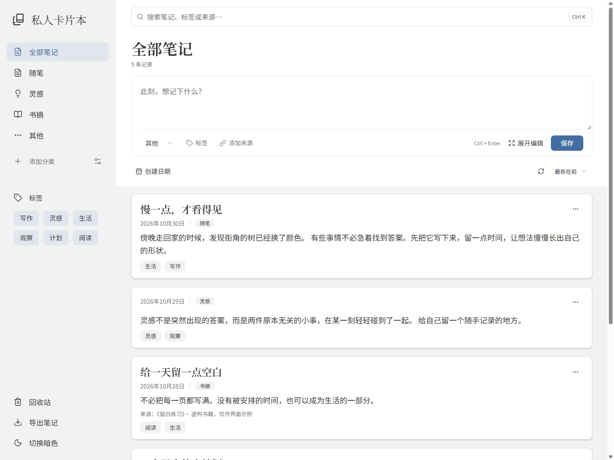
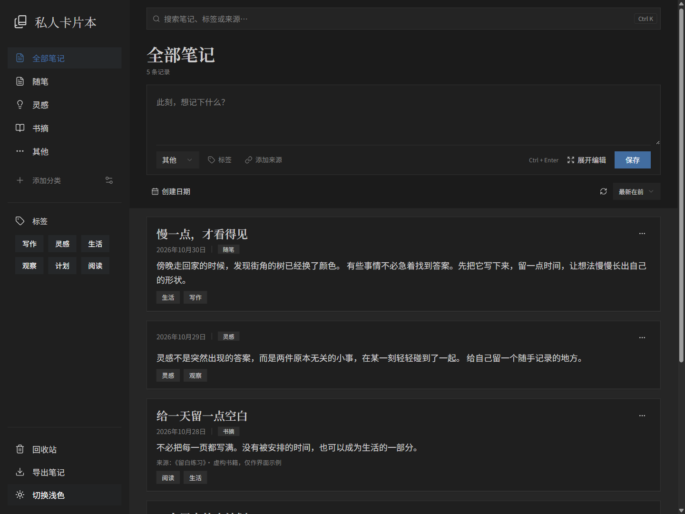
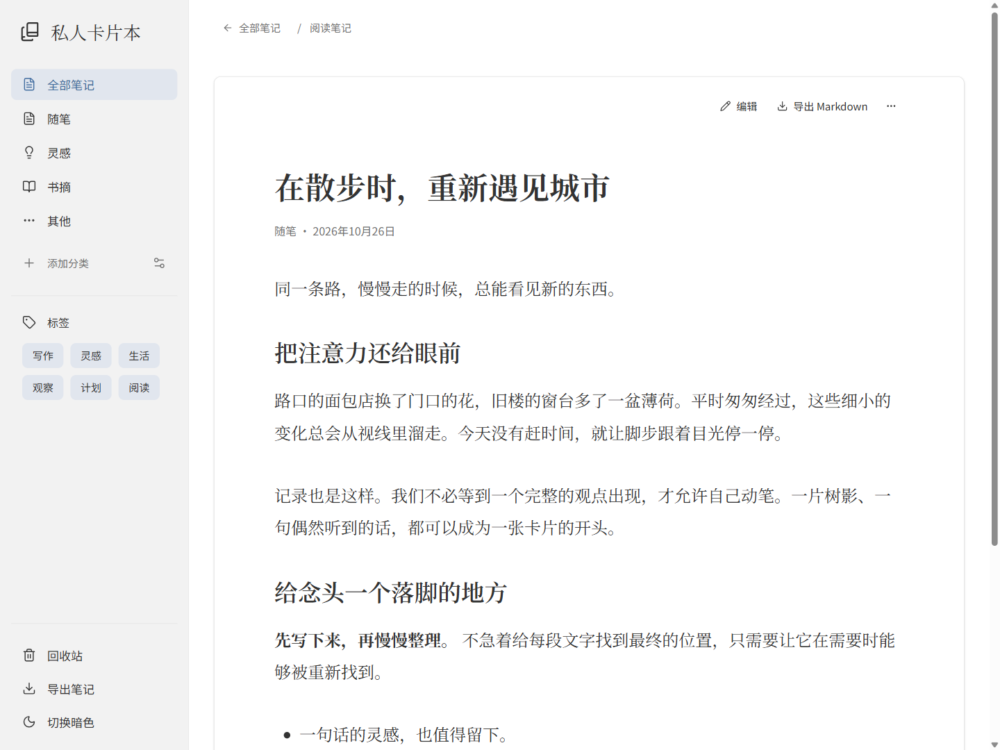
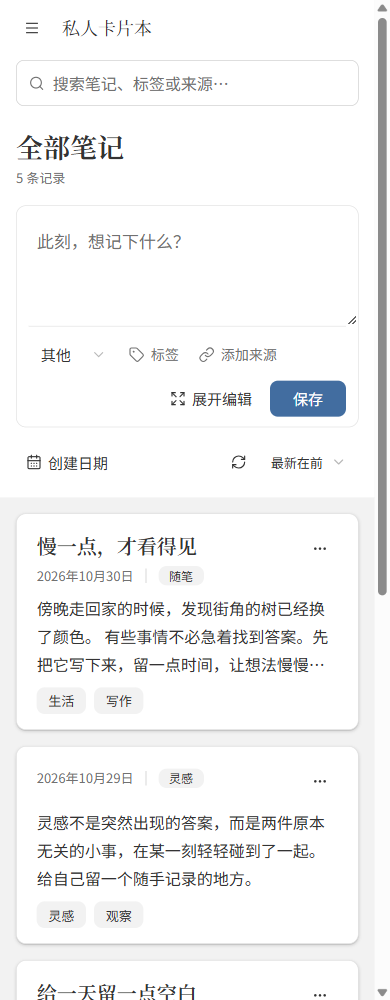
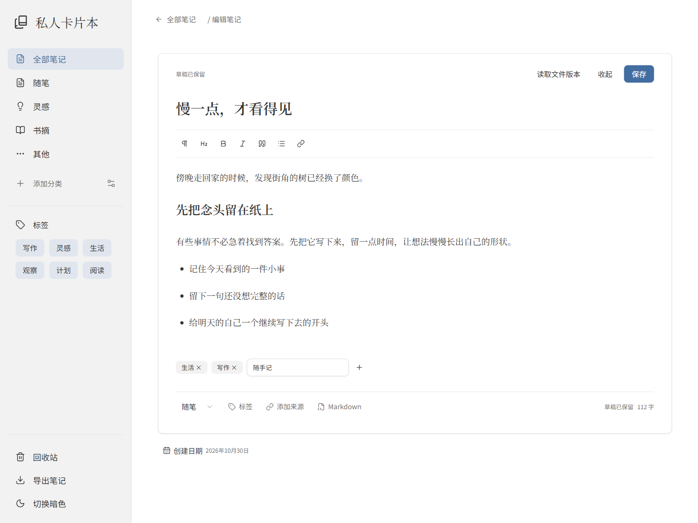
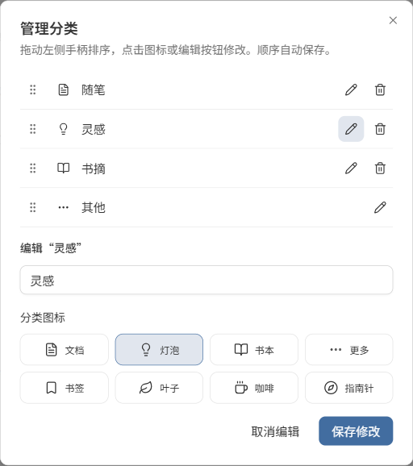

# Card Notebook · 私人卡片本

[中文部署文档](docs/DEPLOY.zh-CN.md) · [English deployment guide](docs/DEPLOY.en.md)

一个供个人使用的卡片式文字笔记本。记录随笔、灵感和摘抄，按分类、标签和关键词查找，随时导出为 Markdown。

A personal, card-based notebook for essays, ideas, and excerpts. Organize with categories and tags, search your writing, and export portable Markdown files.

## 界面预览 / Screenshots

以下图片截取自实际运行的界面，全部使用虚构示例内容。截图中的笔记、标签和书籍来源不会随新部署生成。

These are screenshots of the running application using fictional examples. The notes, tags, and book sources shown here are not seeded into new deployments.

**浅色卡片流 / Light card feed**



<details>
<summary>暗色、阅读与手机版 / Dark theme, reading, and mobile</summary>

**暗色卡片流 / Dark card feed**



**长文阅读 / Long-form reading**



**手机版 / Mobile**



</details>

**富文本与标签编辑 / Rich-text and tag editing**

标签直接在笔记中添加或移除，同一条笔记可以使用多个标签。

Add or remove multiple tags directly in the note editor.



**分类排序与图标 / Category order and icons**

拖动手柄调整顺序，编辑分类名称并从八种图标中选择。

Reorder categories with drag handles, edit names, and choose from eight icons.



## 功能 / Features

- 快捷记录、长文编辑、Markdown 源码、浏览器草稿恢复 / Quick capture, rich-text and Markdown editing, browser draft recovery.
- 单分类、多标签、中文片段搜索，多关键词同时匹配 / Categories, multiple tags, Chinese substring search, AND keyword matching.
- 可补录旧日期，日期按北京时间计算 / Editable dates for older notes; calendar dates use Asia/Shanghai.
- 分类拖动排序、8 个线条图标 / Reorder categories and choose from eight icons.
- 统一阅读页，摘抄可附来源与链接 / A shared reader with optional source details and links.
- 浅色与暗色主题，适配手机窗口 / Light and dark themes with responsive layouts.
- 回收站、单条 Markdown、筛选 ZIP 与完整备份 / Trash, individual Markdown downloads, filtered ZIP exports, full backups.
- 云端通过访问密钥授权浏览器，无需注册账号 / Cloud access with a shared owner key and revocable browser sessions.

## 两种部署方式 / Deployment options

| Mode | Storage | Use case |
| --- | --- | --- |
| 本地 / Local | 每条一个 UTF-8 Markdown 文件 / One UTF-8 Markdown file per note | 本机、离线使用 / Local and offline use |
| 云端 / Cloud | Neon PostgreSQL | Vercel 部署、多设备访问 / Vercel hosting and access from multiple devices |

两种模式不自动同步。仓库不附带笔记数据文件、密钥、数据库凭证或任何已有部署配置。第一次本地启动会创建空库和默认分类；云端先初始化自己的数据库。

The modes do not synchronize automatically. This repository contains no note data files, access keys, database credentials, or existing deployment bindings. Local startup creates an empty notebook; cloud deployment requires initializing your own database first.

## 本地快速开始 / Local quick start

需要 Python 3.13、Node.js 24。Windows 可运行 `安装.cmd`，再运行 `启动卡片本.cmd`。其他平台请参阅部署文档。

Requires Python 3.13 and Node.js 24. On Windows, run `安装.cmd` (install), then `启动卡片本.cmd` (start). See the deployment guide for macOS/Linux and Docker.

## 技术 / Stack

React + TypeScript + Vite + Tailwind CSS v4 + shadcn/ui (Radix), Milkdown, FastAPI, PostgreSQL via psycopg. The UI currently uses Chinese text; the English guide describes the same application.

## Development

```sh
python -m venv .venv
# Activate the environment first; see the deployment guide.
python -m pip install -r requirements.lock.txt
npm ci
python -m pytest tests -q
node --test tests/dates.test.mjs
npm run build
```

Real PostgreSQL tests require a disposable loopback database named `notebook_qa` and `TEST_DATABASE_URL`. Those tests truncate their own application tables. See the guides before enabling them. GitHub Actions runs them against an isolated PostgreSQL service.

## Contributing & license

Bug reports and pull requests are welcome. Please omit personal notes, cookies, credentials, and private deployment details from issues and screenshots. See [CONTRIBUTING.md](CONTRIBUTING.md), [SECURITY.md](SECURITY.md), and [third-party notices](THIRD_PARTY_NOTICES.md).

Released under the [MIT License](LICENSE).
